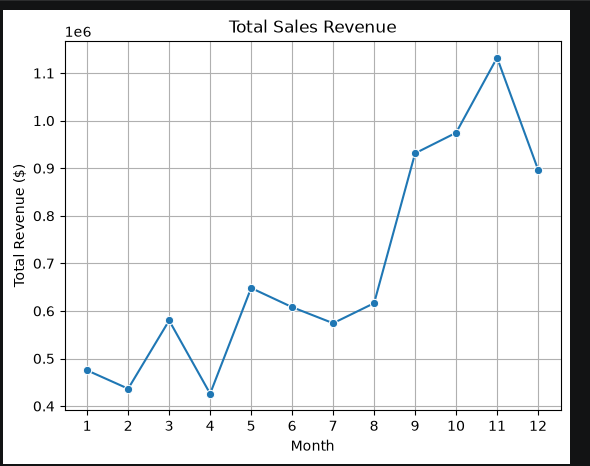
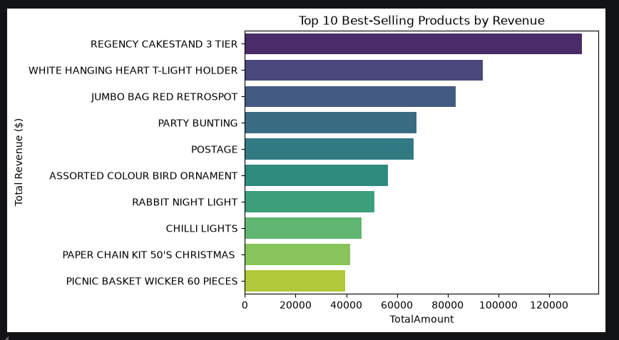
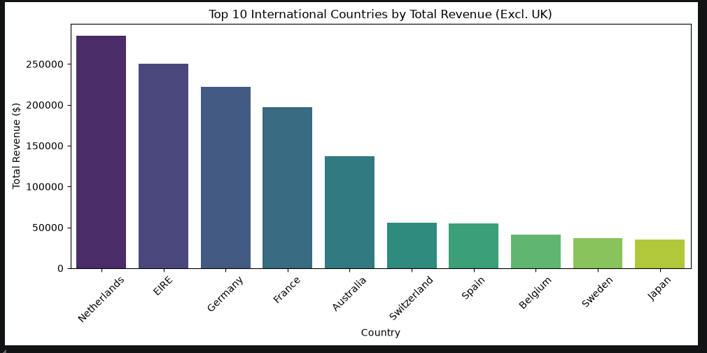
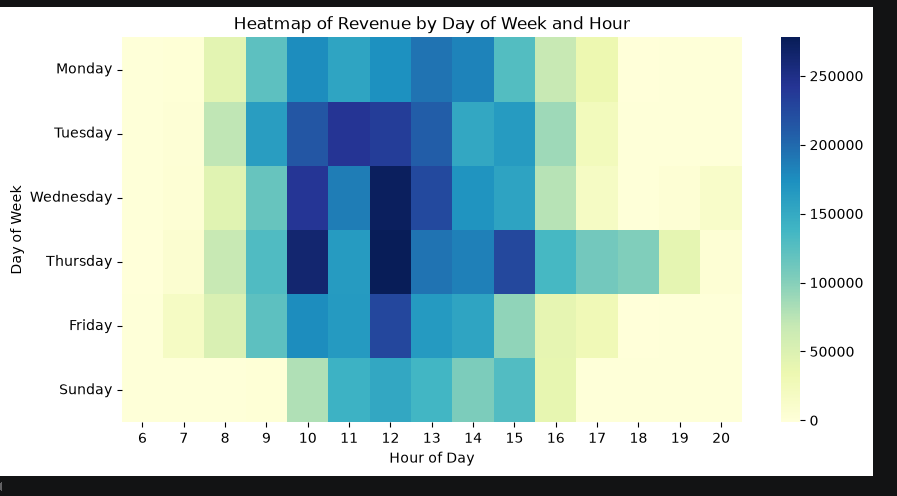

# E-Commerce Sales Analysis: Planning Stock for the Holiday Peak

Python (Pandas, Matplotlib, Seaborn) analysis of 12 months of online retail transactions from a UK-based online gift shop, written for the sales manager who plans holiday stock.

## 1. Business problem

**Who is asking:** the E-commerce Sales Manager.

**Problem statement:** the Sales Manager must decide how much stock to buy, and which products and markets to focus on, for the next holiday peak (Sep–Nov). Using 12 months of transactions (Dec 2010 – Dec 2011: dates, products, quantities, prices, countries, customers), find the seasonal sales trend, the products that drive most revenue and the top markets, so the team can plan peak stock and reduce stockout risk.

**Questions answered:**
1. When in the year do sales peak, and by how much?
2. Which products bring in most of the revenue?
3. Which countries matter most after the UK?
4. At what times of day and week do customers order?
5. How many customers come back?

## 2. Data

Public "Online Retail" dataset (UCI Machine Learning Repository). Prices are in **British pounds (£)**.

| Column | Meaning | Type |
| --- | --- | --- |
| InvoiceNo | order number (starts with "C" if cancelled) | nominal |
| StockCode | product code | nominal |
| Description | product name | nominal |
| Quantity | units on the order line (negative = return) | discrete |
| InvoiceDate | date and time of the order | date/time |
| UnitPrice | price per unit (£) | continuous |
| CustomerID | customer number | nominal |
| Country | customer's country | nominal |

## 3. How I worked (7 steps)

1. **Define:** wrote the problem statement and questions above.
2. **Collect:** loaded the raw CSV (541,909 rows) with Pandas.
3. **Clean:** removed exact duplicate rows, rows with zero or negative price, and rows with no CustomerID (about 25% of rows, which cannot be used for customer analysis). Converted InvoiceDate to datetime. Result: 406,829 rows (`data/cleaned_data1.csv`).
4. **Explore:** summary statistics, quantity distribution, outliers (bulk orders over 1,000 units).
5. **Analyze:** revenue = Quantity × UnitPrice; grouped by month, product, country, day and hour.
6. **Visualize:** monthly revenue line, top 10 products, top 10 countries (excluding UK), day × hour heatmap, quantity histogram.
7. **Communicate:** insights and recommendations below.

## 4. Key numbers (sales only, returns excluded)

| Metric | Value |
| --- | --- |
| Revenue | £8.91M |
| Orders | 18,536 |
| Customers | 4,339 |
| Average order value (AOV) | £481 |
| Returns | 6.9% of revenue |

## 5. Insights

1. **Sep–Nov is the peak.** Revenue rises from £0.95M (Sep) to £1.04M (Oct) to £1.16M (Nov), about 2x a quiet month like Feb (£0.45M). These 3 months bring in £3.15M, **35% of the year**. (Dec 2011 only has data up to 9 Dec.)
2. **A few products carry the business.** The top **20% of products (775 of 3,877) generate 79% of revenue**, a clear 80/20 (Pareto) pattern. Missing stock on these items costs the most.
3. **The UK is 82% of revenue.** The next markets are small: Netherlands 3.2%, Ireland 3.0%, Germany 2.6%, France 2.3%.
4. **Orders come in office hours.** 10 am–3 pm brings **77% of revenue**; there are no orders on Saturdays. This matches a shop that sells a lot to business buyers.
5. **Customers come back.** **66% of customers ordered more than once**, so keeping customers matters as much as finding new ones.

## 6. Recommendations

| Action | Why (the number) | What to watch |
| --- | --- | --- |
| Order peak stock for the top 20% of products by end of July | they make 79% of revenue, and Sep–Nov is 35% of the year | weekly sales vs stock for these products from August |
| Plan stock and staff for a 2x month from September | Sep–Nov revenue is about 2x a quiet month | stockouts and late orders in Sep–Nov |
| Test small marketing pushes in Netherlands, Ireland and Germany | they are the largest markets after the UK (3.2%, 3.0%, 2.6%) | revenue and new customers per country |
| Send promotions on weekdays between 10 am and 3 pm | 77% of revenue arrives in that window | email open and order rate by send time |

## 7. Executive summary

Sales nearly double in Sep–Nov (35% of yearly revenue), and 20% of products make 79% of revenue. The biggest risk is running out of those top products during the peak. **Recommendation:** buy peak stock for the top 20% of products by the end of July and track their stock weekly from August.

## 8. Charts






## 9. Limitations and next steps

- The data has no cost or margin, so this is a **revenue** analysis, not profit.
- There is no delivery or stock data, so stockouts can't be measured directly; the next step is to join stock levels.
- About 25% of rows had no CustomerID and were removed; their sales are not in the customer numbers.
- Next: RFM customer segmentation and month-by-month cohort retention.

## 10. Files

```
ecommerce-eda-project/
├── ecommerce_analysis.ipynb   # cleaning, analysis and charts
├── data/cleaned_data1.csv     # cleaned data (406,829 rows)
└── images/                    # charts used in this README
```

**Tools:** Python, Pandas, NumPy, Matplotlib, Seaborn, VS Code.
